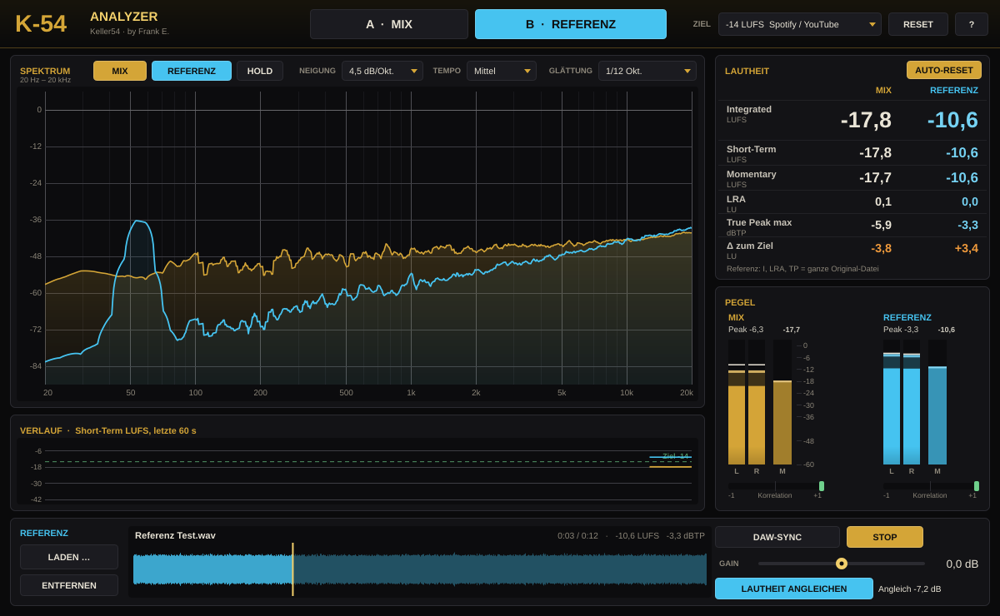

# K-54 Analyzer · Keller54 · by Frank E.

Analyzer-Plugin (AU, VST3, Standalone) mit Spektrum 20 Hz – 20 kHz, Pegel, LUFS nach EBU R128 und A/B-Vergleich mit einem Referenz-Track.

## Bauen
- **GitHub:** Workflow `.github/workflows/k54a.yml` („K-54 Analyzer bauen“) startet bei Änderungen in `K54A/**` und baut `K-54-Analyzer-<Version>-Setup.exe` (Windows) und `K-54-Analyzer-<Version>-Installer.dmg` (Mac, Universal). Release als Beta mit Tag `k54a-v<Version>`.
- **Mac lokal:** `./make-installer.sh`
- **Tests (Linux):** `cmake -B build -DK54A_BUILD_TESTS=ON && cmake --build build --target K54ATest && ./build/K54ATest_artefacts/Release/K54ATest out`
- Neue Version: `project(K54A VERSION …)` in `CMakeLists.txt` hochzählen.

## IDs
- Bundle `de.keller54.k54analyzer`, AU `aufx K5A1 Kl54`
- Parameter: `ab`, `match`, `refGain`, `sync`, `showMix`, `showRef`, `hold`, `slope`, `speed`, `smooth`, `target`, `autoReset`

## Aufbau
- `Source/Loudness.h` – K-Filter, Gating (absolut −70 LUFS, relativ −10 LU), LRA (EBU 3342), True Peak (4× Überabtastung)
- `Source/Spectrum.h` – FFT 8192 (bei 88,2/96 kHz 16384), Hann-Fenster, 640 Punkte logarithmisch
- `Source/PluginProcessor.*` – Messung, Referenz-Wiedergabe (Lade-Thread, Umrechnung auf Projekt-Samplerate), A/B mit 15-ms-Überblendung, Lautheitsangleich
- `Source/PluginEditor.*` – Oberfläche 1200 × 740, skaliert 60–160 %
- Tests: EBU Tech 3341 Fälle 1–4, EBU 3342 LRA, True Peak, A/B, Angleich, Projekt-Wiederherstellung, Mono
